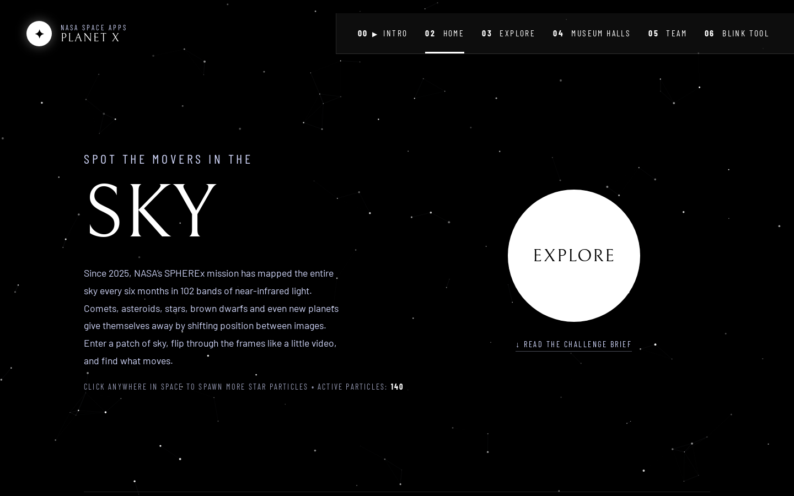
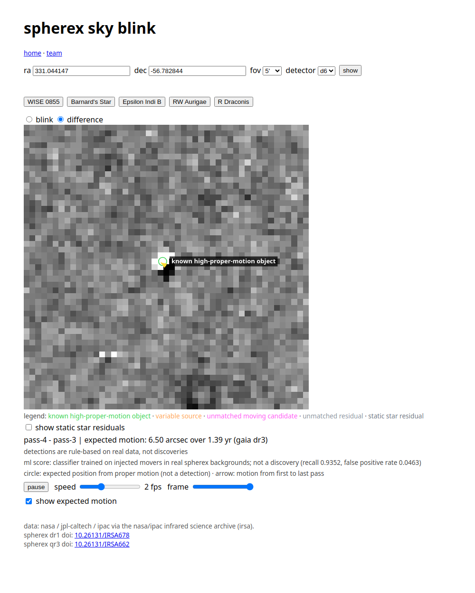
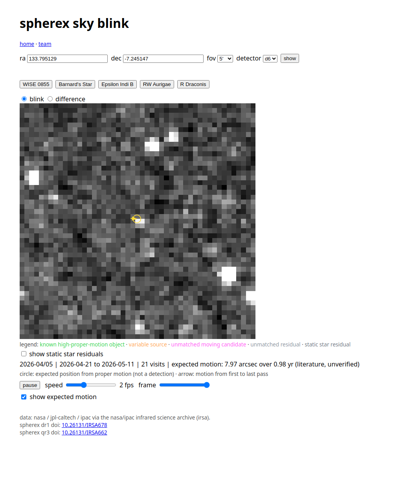
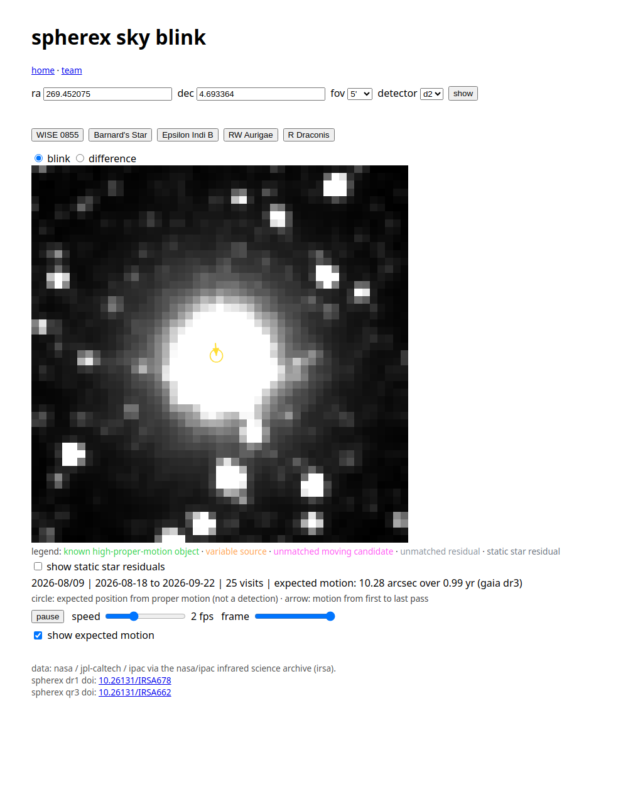
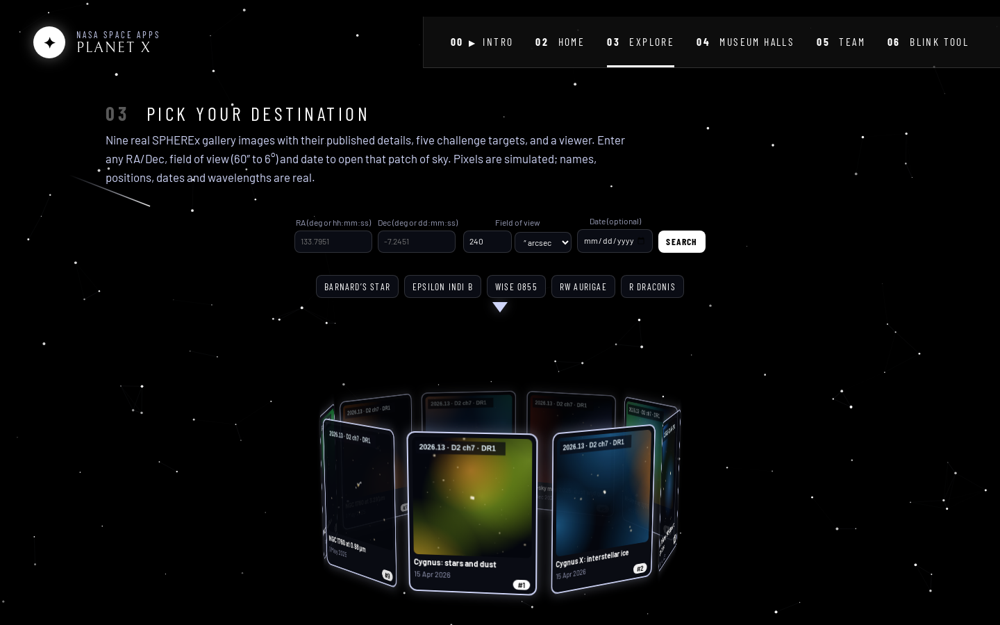
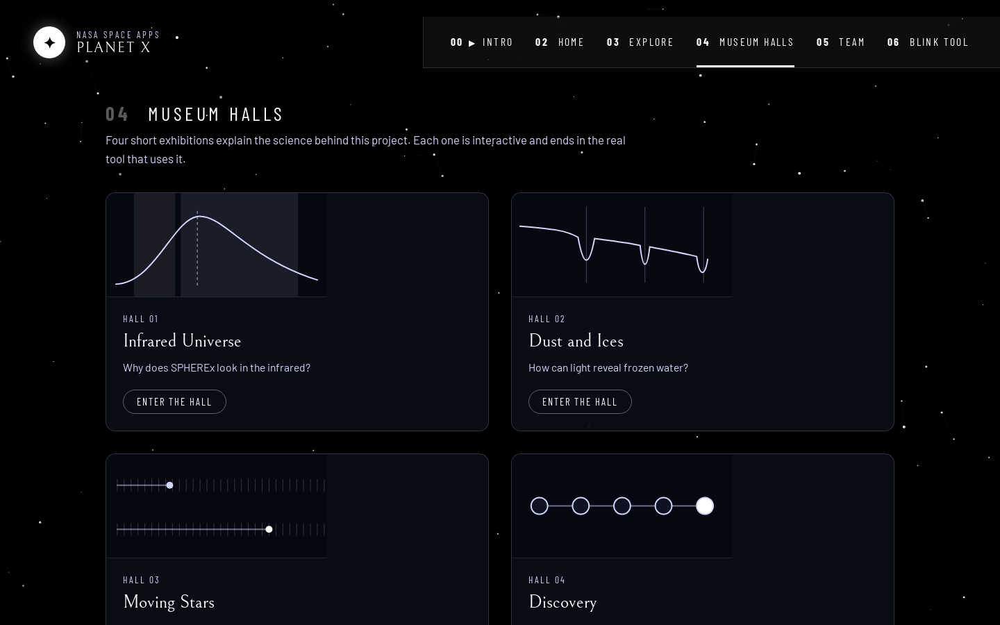

# planetx-nasa26

<p align="center">
  
  &nbsp;
  
</p>
<p align="center">
  
  &nbsp;
  
</p>
<p align="center">
  
  &nbsp;
  
</p>

public web tool to blink spherex sky images over time, so anyone can spot moving and variable objects. built for the 2026 nasa space apps challenge "planet x and spherex". planet x is the motivation: this tool makes no discovery claims.

live demo: https://elsayedelmandoh-planetx-nasa26.static.hf.space
space page: https://huggingface.co/spaces/elsayedelmandoh/planetx-nasa26

## table of contents

- [overview](#overview)
- [key features](#key-features)
- [setup](#setup)
  - [0. prerequisites](#0-prerequisites)
  - [1. clone the repository](#1-clone-the-repository)
  - [2. create the environment](#2-create-the-environment)
  - [3. environment variables](#3-environment-variables)
- [usage](#usage)
- [repository map](#repository-map)
- [benchmark targets](#benchmark-targets)
- [data credit](#data-credit)
- [contributing](#contributing)
- [author](#author)

## overview

**hook / problem.** nasa's spherex mission maps the whole sky every six months in 102 near-infrared bands and returns images of more than a billion objects. comets, asteroids, brown dwarfs, and variable stars reveal themselves by shifting position or brightness between epochs, but no single person can sift through that volume alone. the only route today is to pull fits files from irsa by hand and blink them in a local viewer.

**goal.** a public web tool where anyone types a right ascension and declination, picks a field of view, and watches that patch of sky blink through the spherex epochs, so a moving or variable object is obvious in seconds instead of hours.

**solution / aha moment.** an offline python pipeline pulls real spherex dr1 and qr3 level 2 visits from nasa/ipac irsa (sia v2) and cuts 7.5 arcmin cutouts centred on each target's proper-motion-propagated position (gaia dr3). it masks bad pixels from the flags extension, reprojects to one north-up grid, and median-stacks each survey pass. it then makes background-subtracted difference images between passes and runs a rule-based detector with a gaia dr3 cross-match plus an ml real-bogus classifier. pngs and json land in `web/cache/`, and a static site (youssef's landing design plus the blink tool) plays them. the aha moment is the shift itself: a dot that was not there a second ago, and the tool saying what it is.

**results.** read from `web/cache/index.json`, the pass json files and `web/cache/ml_metrics.json`:

| item | value |
|---|---:|
| benchmark targets | 5 |
| target-detector combinations | 13 |
| survey-pass coadds | 40 (3 or more per target and detector, 4 for epsilon indi b) |
| difference images | 27 |
| spherex visits stacked | 698 (summed over the pass coadds, a visit in two detectors counts twice) |
| classifier recall | 0.935 |
| classifier false positive rate | 0.046 |
| classifier roc auc | 0.992 |
| classifier n_train / n_test | 864 / 216 |

headline: epsilon indi b (detector 6) is detected as a known high-proper-motion object in every difference frame (`diff-1-2`, `diff-2-3`, `diff-3-4`, peaks at 48, 55 and 37 sigma). this is a recovery of a known object, not a discovery.

honest limits:

* static site: no live queries. only precomputed targets are browsable.
* one detector per target for epsilon indi b, rw aurigae and r draconis. wise 0855 and barnard's star have more.
* bright stars saturate. barnard's star core is shown as saturated, not measured.
* wise 0855 motion between passes is below the detection threshold.
* the classifier is trained on injected movers plus real static-star residuals, so its scores rank candidates and are not proof of anything.

## key features

* **coordinate input:** ra and dec in decimal degrees or sexagesimal (`08h 55m 10.8s`), parsed with astropy. shipped.
* **benchmark target presets:** the five required targets as one-click buttons. shipped.
* **url params:** `?ra=...&dec=...&fov=...` plus `det` and `mode`, so any view is shareable. shipped.
* **blink player:** cycles the survey-pass coadds, which is where movers pop. shipped.
* **survey-pass coadds:** median stack of each pass after bad-pixel masking and reprojection. shipped.
* **difference images:** background-subtracted, pass minus pass. shipped.
* **expected-motion arrow:** drawn from gaia dr3 proper motion. shipped.
* **rule-based detector + gaia cross-match:** 5-sigma threshold, dipole pairing, proper-motion match, gaia dr3 labels. shipped.
* **ml score:** real-bogus classifier score per detection. shipped.
* **saturated-core display:** saturated pixels render white. shipped.
* **offline re-render:** rebuild frames from cached cutouts with `--offline`. shipped.
* **live queries for any coordinate:** not shipped. the site is static.
* **102-band spectra:** not shipped.
* **flag overlay:** not shipped.
* **aladin panel:** not shipped.

## setup

### 0. prerequisites

before running this project, ensure you have the following installed:

* [git](https://git-scm.com/)
* [uv](https://docs.astral.sh/uv/), or python 3.12 with pip
* network access to irsa for precompute runs, serving and tests need none
* optionally [anaconda](https://www.anaconda.com/) or miniconda if you prefer a conda environment

### 1. clone the repository

```bash
git clone https://github.com/elsayedelmandoh/planetx-nasa26
cd planetx-nasa26
```

### 2. create the environment

```bash
# with uv, what the repo and ci use
uv sync

# or with conda
conda create -n planetx-nasa26 python=3.12 -y
conda activate planetx-nasa26
pip install -e . pytest httpx ruff
```

### 3. environment variables

copy the example file and fill it in. `.env` is gitignored, never commit it.

```bash
cp .env.example .env
```

| variable | default | what it does |
|---|---|---|
| `ENV` | `development` | runtime environment label |
| `LOG_LEVEL` | `INFO` | log verbosity |
| `API_HOST` | `0.0.0.0` | api bind address |
| `API_PORT` | `8000` | api port |
| `INBOUND_API_KEY` | empty | when set, requests must send `x-api-key` |

values that are not secret, the data release, the fov presets, and the benchmark targets, live in `configs/default.yaml`. `.env` overrides the yaml when both set the same key.

## usage

to run the application locally:

```bash
make serve
```

then open http://localhost:8000/

| command | what it does |
|---|---|
| `make serve` | run the fastapi app with reload on port 8000 |
| `make test` | run the offline test suite |
| `make eval` | run the offline eval gate |
| `make lint` | ruff check plus format check |
| `make format` | ruff format plus ruff autofix |

the api answers `GET /health` and `GET /api/targets`. the frontend is served from `web/` at `/`. the live site is a static hugging face space that serves `web/` as is.

precompute (needs irsa network access, `--offline` re-renders from cached cutouts):

```bash
uv run python -m src.utils.data_acquisition --target "<name>" --detector dN   # one target and detector
uv run python -m src.utils.data_acquisition --all                              # every target
uv run python -m src.utils.data_acquisition --all --offline                    # re-render only
uv run python -m src.utils.ml_classifier train
uv run python -m src.utils.ml_classifier score
uv run python -m src.evals.runner --gate
```

## repository map

| path | holds |
|---|---|
| `web/` | static site: `home.html` (landing), `index.html` (blink tool), `team.html`, `app.js`, `styles.css`, `cache/` (precomputed pngs, json, `index.json`, `ml_metrics.json`) |
| `src/api/` | fastapi app and routes, serves `web/` at `/` |
| `src/core/` | settings loader (`configs/*.yaml` + `.env`), logging |
| `src/utils/` | `data_acquisition.py` (irsa pull, cutouts, passes, cache), `data_processing.py` (masking, reprojection, stacking, difference, detector), `ml_classifier.py` (real-bogus train and score), coordinate parsing |
| `src/evals/` | offline eval gate: checks the 5 targets each have 3 or more survey passes |
| `configs/` | values: data release, fov presets, benchmark targets |
| `data/` | `raw/` downloads, `processed/` cached cutouts, `samples/` small fixtures |
| `evals/` | benchmark notes and figures |
| `notebooks/` | exploration: data acquisition, eda, data processing |
| `tests/` | unit, integration. offline by default |
| `docs/project-definition/` | problem, goal, architecture, api contract, decision log |
| `docs/deliverables/` | presentation draft (`02-presentation/`), screenshots (`03-screenshots/`) |
| `docs/.internal/` | agent plans and notes, not product docs |
| `.github/workflows/` | `ci.yml` (lint, test, eval gate) and `deploy.yml` (static hugging face space deploy) |

every folder holds an `00-quickstart.md` with the details for that folder.

## benchmark targets

| target | ra (deg) | dec (deg) | kind | detector | survey passes |
|---|---:|---:|---|---|---:|
| WISE 0855 | 133.795129 | -7.245147 | fast-moving brown dwarf | d1, d2, d4, d5, d6 | 3 each |
| Barnard's Star | 269.452075 | +4.693364 | high proper-motion red dwarf | d1 to d5 | 3 each |
| Epsilon Indi B | 331.044147 | -56.782844 | binary brown dwarfs | d6 | 4 |
| RW Aurigae | 76.956375 | +30.401389 | variable star | d2 | 3 |
| R Draconis | 248.167625 | +66.755000 | variable star | d3 | 3 |

coordinates live in `configs/default.yaml` and load as preset buttons from `GET /api/targets`. detectors and passes come from `web/cache/index.json`.

## data credit

spherex data: nasa / jpl-caltech / ipac via the nasa/ipac infrared science archive (irsa).

- spherex dr1 doi: [10.26131/IRSA678](https://doi.org/10.26131/IRSA678)
- spherex qr3 doi: [10.26131/IRSA662](https://doi.org/10.26131/IRSA662)

## contributing

contributions are welcome! if you'd like to improve this project, please follow these steps:

1. fork the repository.
2. create a branch for your feature or bug fix (`git checkout -b feature/my-new-feature`).
3. keep the repeatable logic in `src/`, not in a notebook, and add one small test for it.
4. commit your changes with clear messages (`git commit -m 'add some feature'`).
5. push to your fork (`git push origin feature/my-new-feature`).
6. make sure `make lint` and `make test` pass.
7. open a pull request.

## author

the team behind planetx-nasa26, built for the 2026 nasa space apps challenge "planet x and spherex".

| member | role |
|---|---|
| elsayed elmandoh | data engineer, research, project lead |
| youssef | web frontend |
| mostafa | research |
| salma | research |
| hazem | devops and coding |
| mohsen | graphics |

[](https://github.com/elsayedelmandoh/planetx-nasa26)
[](https://www.spaceappschallenge.org/2026/challenges/planet-x-and-spherex/)

[](https://www.linkedin.com/in/elsayed-elmandoh-b5849a1b8/)
